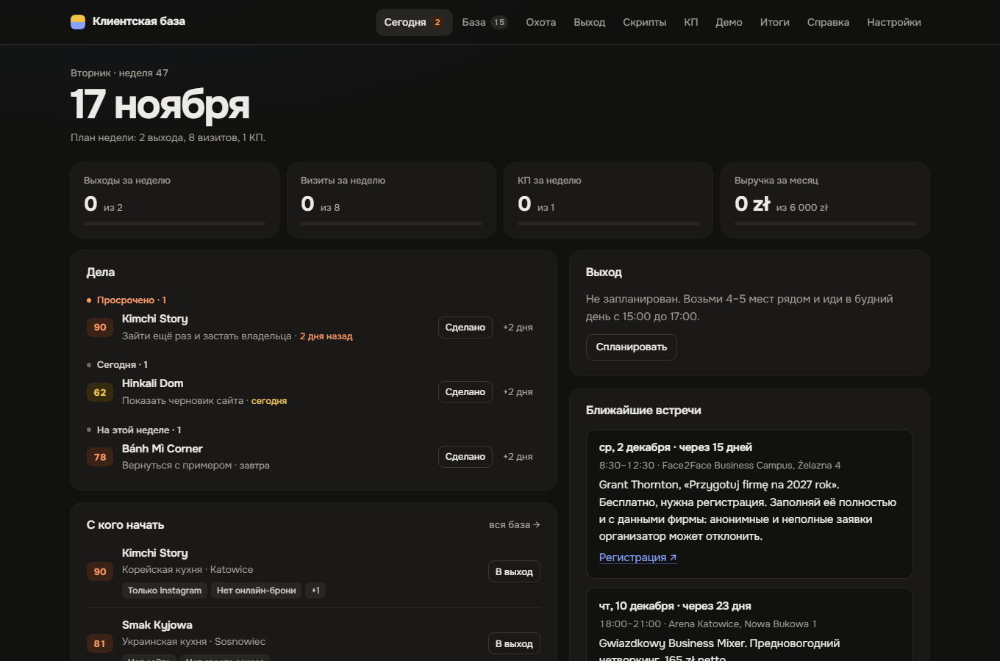
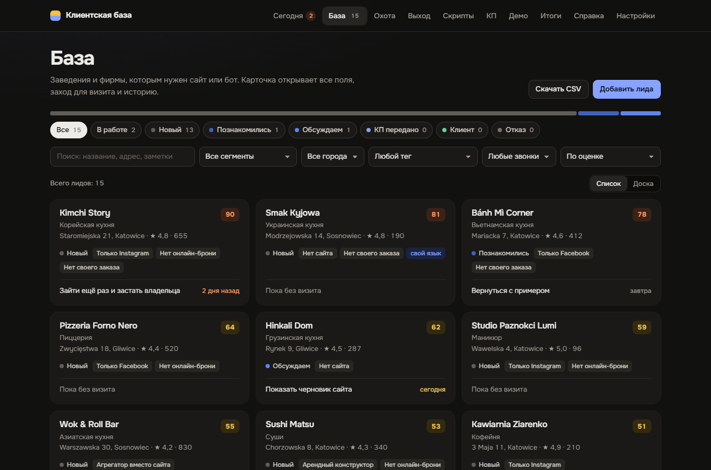
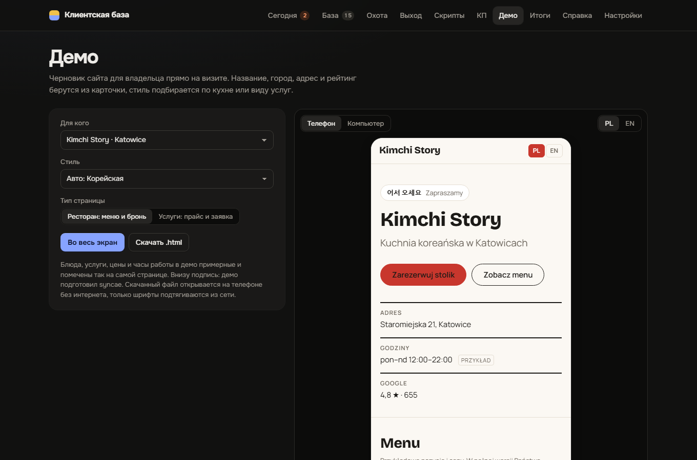

# Client Base

A field sales workspace for a small web studio that sells websites and Telegram bots to local businesses in Silesia, Poland. The sales model is walking in: you visit a restaurant or a salon, show a finished site on your phone and leave a proposal. This page keeps that loop in one place, from who to visit tomorrow to what the owner said last time.

The interface is in Russian. Everything a client sees (visit scripts, proposals, demo sites) comes in Polish, Ukrainian, Russian or English.



## What's inside

- **Today**: weekly goals, overdue and upcoming follow-ups, the leads worth visiting next, local networking events.
- **Base**: leads as a list or a status board. Each lead is scored by what its Google listing lacks (no website, Instagram only, a delivery app instead of a site, no online booking), by rating and by priority. Calls are logged as reached or not reached: a missed call sets "call back" for the next working day, and the base can be filtered by the last call result.
- **Hunt**: a city and category checklist for combing Google Maps, and a paste box that turns copied listing text into leads and catches duplicates.
- **Outing**: plan a day of visits, open the walking route in Google Maps, then go stop by stop with four buttons: not there, talked, interested, refused. Status, next step and its date follow from the result. A wrong tap can be fixed later, because the outing remembers each lead's state from before the visit.
- **Scripts**: openers and answers to common objections in four languages, filled in with the lead's city, problem and a matching case study. Follow-up messages stay locked until the lead agrees to be contacted: Polish law (art. 398 of the Electronic Communications Law) bans unsolicited commercial messages and calls, B2B included.
- **Proposal**: a one-page offer built from the lead's issues and the chosen packages, saved as a standalone HTML file.
- **Demo**: a draft website for the venue in one of 20 styles, matched to the cuisine or the type of service, to show during the visit.
- **Stats**: the funnel, visits per week against the goal, refusal reasons, results by segment.
- **Guide** and **Settings**: segments, channels, legal notes and visit tips; prices, contacts, goals and case links.





## How it runs

The page is published as a claude.ai artifact. Data lives in the artifact's database (the `db` capability), files are saved through `downloads`, and an optional writing helper in Scripts uses `sample`. Outside that runtime the page shows a notice instead of data.

There is no framework and nothing to install. The source is a handful of plain JS files that `build.mjs` concatenates into one HTML page:

```
src/head.html     title, meta, fonts
src/style.css     styles, light and dark theme tokens
src/body.html     layout shell, navigation, guide template
src/presets.js    statuses, segments, tags, packages, cases, phrases, demo styles
src/core.js       helpers, state, database writes, lead scoring
src/docs.js       proposal and demo site generation, rendered in shadow DOM
src/views.js      markup for every view and the lead drawer
src/actions.js    event handlers, database subscriptions, startup
build.mjs         builds dist/client-base.html and test/index.html
```

## Build

```bash
node build.mjs
```

`dist/client-base.html` is the page to publish. `test/index.html` is the same page wired to an in-memory mock of the artifact runtime.

## Running locally

```bash
python -m http.server 8766 --bind 127.0.0.1
```

Open `http://localhost:8766/test/index.html`. The mock in `test/mock.js` keeps the database in memory and loads fictional leads from `test/seed.js`, so a reload starts over.

- `?nodb` opens the page without a database, `?ro` in read-only mode.
- `__mock.fail = 'unavailable'` in the console fails the next write once (the page retries it on its own).
- `__mock.fail = 'not_granted'` rejects the next write and the page switches to read-only.
- `__mock.latency = 400` slows the database down.

After a rebuild, change the query string (`?v=2`): browsers like to serve the old page from cache.

## Data

### `leads`

| Field | Meaning |
|---|---|
| `name`, `kind`, `address`, `city`, `phone` | name, what kind of place it is, address, city, the venue’s public phone number |
| `segment` | `horeca`, `beauty`, `services`, `build`, `tgshop`, `b2b`, `discord`, `other` |
| `rating` | as shown on Google: `"4,6 · 616"` |
| `site`, `maps` | the listing's website link and a Google Maps link |
| `priority` | 1 hot, 2 warm, 3 cold |
| `status` | `new`, `contact`, `talk`, `offer`, `won`, `lost` |
| `lang` | `true` if the owner speaks Ukrainian or Russian; the opener is then in Ukrainian, otherwise in Polish |
| `tags` | what the listing lacks, keys from `P.TAGS` |
| `packages` | chosen packages; empty means the suggested ones are used |
| `now`, `pitch`, `notes` | what is wrong now, what to offer, free notes |
| `next`, `nextDate` | next step and its date, `YYYY-MM-DD` |
| `value` | deal value, PLN |
| `decider` | who decides and when they are around |
| `consent`, `consentDate`, `consentHow` | consent to be contacted: whether, when, how |
| `wonAt`, `lostAt`, `lostFrom`, `lostReason` | closing details; `lostFrom` is the stage the lead dropped out at |
| `source`, `created`, `updated` | where the lead came from, ISO timestamps |

Tags: `nosite`, `insta`, `fb`, `aggregator`, `deaddomain`, `rented`, `oldsite`, `nobooking`, `noorder`, `nolang`, `budget`, `chain`. Every tag except `budget` and `chain` turns into a line of the client's proposal, so only tag what the Google listing actually shows.

### `activity`

`leadId`, `type` (`visit`, `talk`, `call`, `msg`, `meeting`, `offer`, `status`, `note`), `date`, `created`, `text`. Visits also carry `result` (`absent`, `talked`, `interested`, `refused`) and `outingId`; calls carry `result` `reached` or `noanswer`; status changes carry `from` and `to`.

### `outings`

`date`, `leads` (ids in route order), `results` (`{leadId: result}`), `base`, `done`, `doneAt`, `created`. `base` stores each lead's status and next step from before its first result in this outing, which is what lets a mis-tap be corrected cleanly.

### `settings/main`

`profile` (`brand`, `about`, `portfolio`, `phone`, `email`), `goals` (`outings`, `visits`, `offers`, `month`), `prices.<package>.from/to`, `cases.<case>` (custom link), `hunt.<city>__<category>` (date it was combed), `aiEnabled`. An empty value falls back to `P.DEFAULTS`.

## Adding leads

Use **Добавить лида** in Base, or paste listings in Hunt. Documents written straight into the `leads` collection show up live as well.

## License

[MIT](LICENSE)
